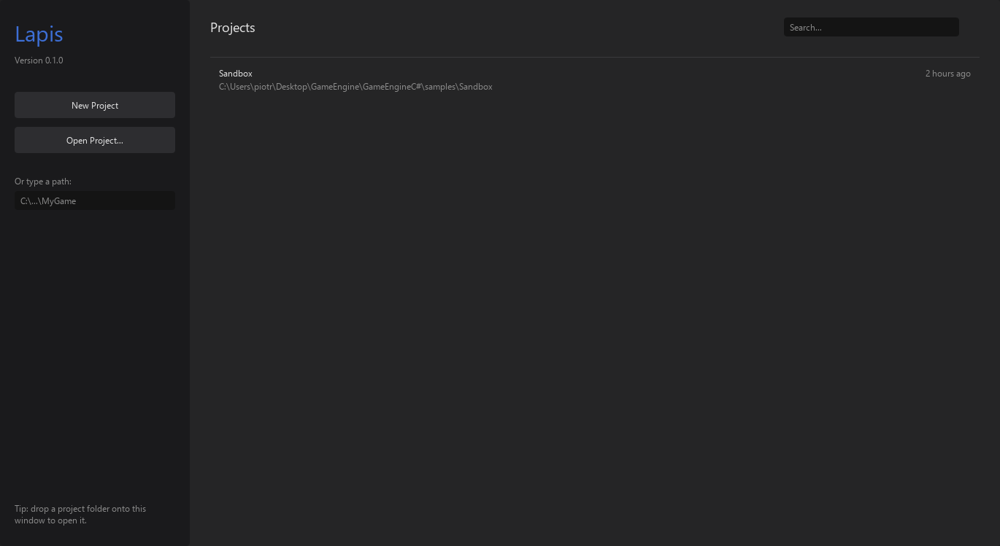
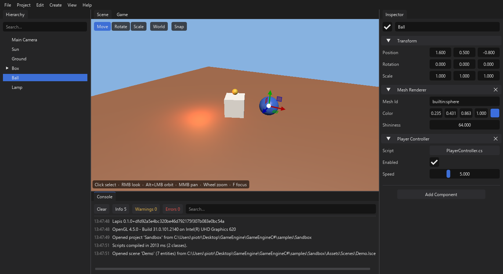
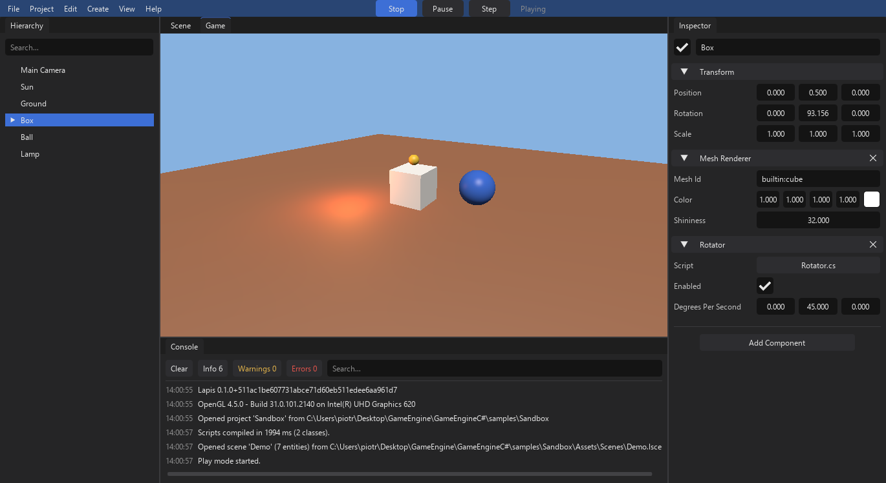
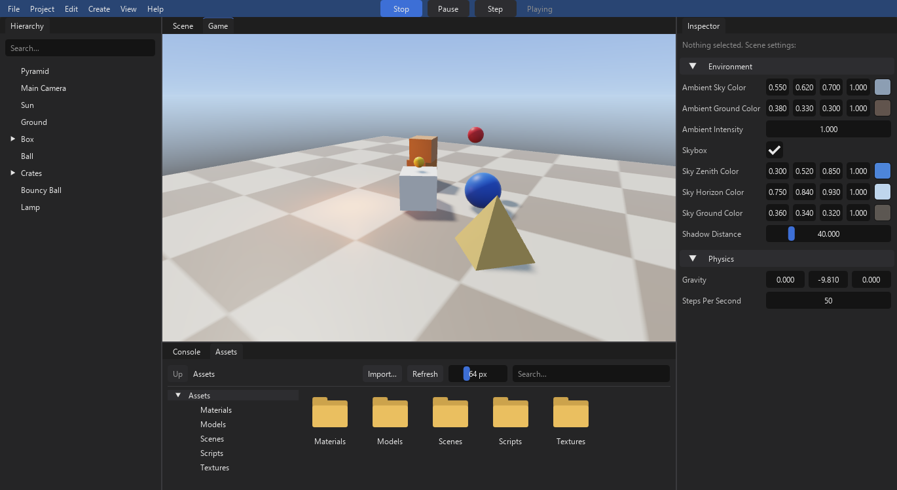

# Lapis

Lapis is a small 3D game engine with a visual editor, written entirely in C#.
Build scenes in the editor, write gameplay in C# scripts, and export your game as a standalone app for Windows, Linux or macOS.

> **Status:** early development — the editor, C# scripting, physics, assets and export work on Windows, Linux and macOS.

## Quick start

Download the latest editor, unpack it and run it. Nothing else needs to be installed.

**Linux** (terminal):

```bash
curl -L https://github.com/ikimas777/Lapis-3DGameEngine/releases/latest/download/Lapis-Linux-x64.tar.gz | tar -xz && ./Lapis/Lapis.Editor
```

**Windows** (PowerShell):

```powershell
irm https://github.com/ikimas777/Lapis-3DGameEngine/releases/latest/download/Lapis-Windows-x64.zip -OutFile Lapis.zip; Expand-Archive Lapis.zip .; .\Lapis\Lapis.Editor.exe
```

**macOS** (Terminal; use `Lapis-macOS-x64.zip` on an Intel Mac):

```bash
curl -LO https://github.com/ikimas777/Lapis-3DGameEngine/releases/latest/download/Lapis-macOS-arm64.zip && ditto -x -k Lapis-macOS-arm64.zip . && open Lapis/Lapis.app
```

While the repository is private, these links need a signed-in account: use the [GitHub CLI](https://cli.github.com)
instead (`gh auth login` once), for example on Linux:

```bash
gh release download --repo ikimas777/Lapis-3DGameEngine --pattern Lapis-Linux-x64.tar.gz && tar -xzf Lapis-Linux-x64.tar.gz && ./Lapis/Lapis.Editor
```

More options are under [Download](#download).

```csharp
using System;
using System.Collections.Generic;
using System.Linq;
using System.Numerics;
using Lapis;

public class PlayerController : Behaviour
{
    public float speed = 5.0f;

    public override void Update()
    {
        float x = Input.GetAxis("Horizontal");
        float z = Input.GetAxis("Vertical");

        transform.Position += new Vector3(x, 0, -z) * speed * Time.DeltaTime;
    }
}
```

## Requirements

- Windows 10/11 x64, 64-bit Linux (X11 or Wayland with XWayland), or macOS 13+ (Apple Silicon or Intel)
- [.NET 10 SDK](https://dotnet.microsoft.com/download/dotnet/10.0)
- GPU with OpenGL 4.5 support (on macOS: the system's OpenGL 4.1, which every supported Mac has)

## Building

```bash
dotnet build Lapis.slnx
```

```bash
dotnet test --solution Lapis.slnx
```

## Download

Ready-to-run builds for every system are on the [Releases](../../releases) page. They include .NET, so
nothing else needs to be installed:

- **Windows:** `Lapis-Windows-x64.zip` — unzip and run `Lapis.Editor.exe`.
- **Linux:** `Lapis-Linux-x64.tar.gz` — extract (`tar -xzf Lapis-Linux-x64.tar.gz`) and run `Lapis/Lapis.Editor`.
  Optional: install `zenity` (or `kdialog`) for the folder chooser and `code` (VS Code) for editing scripts.
- **macOS:** `Lapis-macOS-arm64.zip` (Apple Silicon: M1 and newer) or `Lapis-macOS-x64.zip` (Intel) — unzip and
  open `Lapis/Lapis.app` (you can move it to Applications). The app is not signed with an Apple developer
  certificate, so a downloaded copy is stopped the first time: right-click `Lapis.app` > **Open** > **Open**, or
  allow it under System Settings > Privacy & Security > **Open Anyway**. Updates from the launcher are not
  stopped. On a Mac, Cmd takes the place of Ctrl in every shortcut (Cmd+S, Cmd+Z, Cmd+click).
  The renderer uses OpenGL 4.1, the newest version Apple provides; the picture is the same as on Windows and Linux.

Keep the `Runtime` folder next to the editor (inside `Lapis.app/Contents/MacOS` on a Mac): it is the game runtime (the engine without the editor) that exported games are built from. The package also has `Docs/` (these guides), `README.txt` and `LICENSE.txt`.

### Updates

The project launcher checks GitHub for a newer release when it opens (this can be turned off in the update
window). When one is found, the **Lapis Update** window shows what is new, and **Update to x.y.z** downloads the
package for your system (`Lapis-Windows-x64.zip` on Windows, `Lapis-Linux-x64.tar.gz` on Linux, `Lapis-macOS-arm64.zip` or `Lapis-macOS-x64.zip` on a Mac) and replaces the
editor's files in the folder it runs from — `Lapis.Editor`, `Runtime/Lapis.Runtime`, `Docs`, `README.txt` and `LICENSE.txt`, like pulling a new
version. Other files there, settings and projects are not touched. **Restart Now** starts the new version; the
replaced files are kept as `.old` until the next start and then deleted. The **Check for updates** link under the
version number opens the window at any time.

An editor started from source code (`dotnet run`) is updated with `git pull` instead; its update window only
offers to download the package.

The **update channel** in the same window chooses which releases are offered: **Stable** (finished releases
only, the default), **Beta** (also betas) or **Alpha** (everything).

### Version numbers

Versions are `X.Y.Z`, optionally with a stage:

| Part | Meaning | Example |
|---|---|---|
| `X` | Major update: big changes that may need projects or scripts to be updated | `1.0.0` |
| `Y` | General update: new features (`Z` goes back to 0) | `0.7.0` |
| `Z` | Hotfix: bug fixes only | `0.7.1` |
| `-alpha.N` | Alpha: features are still being built and may change | `0.8.0-alpha.1` |
| `-beta.N` | Beta: features are done, bugs are being fixed | `0.8.0-beta.2` |

They are ordered `0.8.0-alpha.1 < 0.8.0-alpha.2 < 0.8.0-beta.1 < 0.8.0`. Alphas and betas are published as
pre-releases, so the Releases page's "Latest" is always a stable version. While `X` is 0 the engine is in early
development; `1.0.0` will be the first stable version.

## Editor executable (Windows)

A ready-to-run editor is committed in the repository root: double-click **`Lapis.Editor.exe`**
(it includes .NET and runs on any 64-bit Windows 10/11 PC). Keep the `Runtime` folder next to it: exported games
are built from `Runtime\Lapis.Runtime.exe`.

To rebuild it after changing the code:

```powershell
.\scripts\publish-editor.ps1 -RepoRoot
```

Without `-RepoRoot` the build only goes to `publish\Lapis.Editor`. Add `-Shortcut` to also put a
"Lapis Editor" shortcut on the desktop. The executable has no console window; its messages are shown in the
Console panel and written to `%LOCALAPPDATA%\Lapis\editor.log`.

On Linux, build the editor with:

```bash
./scripts/publish-editor.sh
```

The result is `publish/Lapis.Editor-linux/Lapis.Editor` (messages go to `~/.local/share/Lapis/editor.log`).

On macOS the same script builds `publish/Lapis.Editor-macos/Lapis.app` for the Mac it runs on (`LAPIS_RID=osx-x64`
builds for Intel Macs); messages go to `~/Library/Application Support/Lapis/editor.log`. From a clone you can
also start the editor directly with `dotnet run --project src/Lapis.Editor`.

## AI assistants (MCP)

The **MCP** tab at the right edge of the Scene view starts a local [Model Context Protocol](https://modelcontextprotocol.io/)
server. AI assistants such as Claude Code, Claude Desktop or Codex can then look at the scene, create and change
entities, write scripts, take screenshots and run the game, while you watch in the editor; every change can be undone
with Ctrl+Z.

Click **Start Server** in the MCP tab, then connect the assistant once (the default port is 47800):

**Claude Code** — run in a terminal in your project folder:

```
claude mcp add --transport http lapis http://127.0.0.1:47800/mcp
```

**Claude Desktop** — in **Settings > Developer > Edit Config**, add this inside `"mcpServers"` in
`claude_desktop_config.json` and restart Claude Desktop (needs [Node.js](https://nodejs.org/)):

```json
"lapis": {
  "command": "npx",
  "args": ["-y", "mcp-remote", "http://127.0.0.1:47800/mcp"]
}
```

**Codex** — run in a terminal:

```
codex mcp add lapis --url http://127.0.0.1:47800/mcp
```

The [MCP guide](docs/mcp.md) has more options (project-wide `.mcp.json`, `config.toml` for Codex) and lists every
tool the assistant can use.

## Performance monitor

**Debug > Lapis Monitor** opens Lapis Monitor, a separate window with live charts of the running editor or game:
frame time, rendering, physics, memory and garbage collection, errors, cache misses and free disk space. It raises
alerts (hitches, leaks, errors, a filling disk) and records every run to `%LOCALAPPDATA%\Lapis\Monitor\Sessions`.
It can also be started on its own (`Lapis.Monitor.exe`, or `dotnet run --project src/Lapis.Monitor`) and attaches
to the editor by itself. See the [monitor guide](docs/monitor.md).

Release packages include the monitor. In a clone of the repository it is built once from its sources (the committed
`Lapis.Editor.exe` does not need this):

1. Install the [.NET 10 SDK](https://dotnet.microsoft.com/download/dotnet/10.0).
2. In a terminal in the repository folder, run `dotnet build src/Lapis.Monitor`.
3. Click **Debug > Lapis Monitor** in the editor.


## Running

```bash
dotnet run --project src/Lapis.Editor
```

The editor starts with the project launcher: pick a recent project, open a project folder, or create a new
project from a starter template. **Project > Close Project** returns to it.



To skip the launcher and open the sample project directly:

```bash
dotnet run --project src/Lapis.Editor -- --project samples/Sandbox
```



### Scripting

Scripts are C# classes in a project's `Assets` folder. The editor compiles them itself and reloads them
while it runs whenever a file is saved — see the [scripting guide](docs/scripting.md).

### Play mode

Press **Play** (Ctrl+P) in the middle of the menu bar to run the game in the Game view. In the sample
project, W A S D / arrow keys move the blue ball and the box spins. **Pause** (Ctrl+Shift+P) freezes the
game and **Step** (Ctrl+Alt+P) advances it by one frame. The menu bar turns blue while playing: changes
made during play are thrown away on **Stop**, and the scene returns to exactly how it was.

While the game has the mouse, the cursor is hidden and held in the window (handy for a first-person camera).
**Esc** releases it so you can use the editor while the game keeps running; click the game picture in the Game view to return to the
game. Ctrl+P stops Play mode at any time.



### Console

The **Console** panel shows messages from the editor and from `Log.Info` / `Log.Warning` / `Log.Error` in scripts.

- Drag over a message's text to select words or letters (double-click selects a word) and press **Ctrl+C** to
  copy them.
- Click a message's time or the empty space after it to select the whole message (Ctrl+click adds one,
  Shift+click selects a range, Ctrl+A selects all) and press **Ctrl+C**, or right-click for **Copy**,
  **Copy Message Text Only** and **Copy All**.
- **Clear on Play** (next to **Clear**) empties the Console every time Play starts; the choice is remembered.
- Double-click a script error to open the file at that line.

### Assets

Models (glTF, GLB, OBJ, STL), textures and materials live in the project's `Assets` folder and are managed
in the **Assets** panel: drag files in from Explorer (or your Linux file manager), then drag assets into the scene or onto Inspector fields.
See the [assets guide](docs/assets.md).

### Exporting

**File > Export Game...** builds a standalone executable of the open project for the system the editor runs on
(a Windows `.exe`, or a Linux executable)
without the editor or .NET. See the [export guide](docs/export.md).

### Physics

Colliders and rigid bodies are simulated with [Jolt](https://github.com/jrouwe/JoltPhysics) while the game
runs. In the sample, the blue ball (a kinematic body you steer) pushes the crates, and the red ball bounces.
See the [physics section of the scripting guide](docs/scripting.md#physics).



### Scene view controls

| Input | Action |
|---|---|
| Left click | Select the object under the cursor |
| Ctrl + left click / Shift + left click | Add an object to the selection (Ctrl removes it again) |
| W A S D / Q E | Fly (hold Shift to go faster) — no mouse button needed |
| Right mouse + drag | Look around (flying keeps working while you hold it) |
| Alt + left mouse + drag | Orbit around the focus point |
| Middle mouse + drag | Pan |
| Mouse wheel | Zoom |
| F | Focus the selected entity |

**Options > Keybindings** lets you choose how flying works: with W A S D / Q E at any time (the default), or only
while holding the right mouse button — then W / E / R also pick the Move / Rotate / Scale tools.

### Editor shortcuts

| Keys | Action |
|---|---|
| Ctrl+N | New scene |
| Ctrl+O | Open scene |
| Ctrl+S / Ctrl+Shift+S | Save / Save As |
| Ctrl+Z / Ctrl+Y (or Ctrl+Shift+Z) | Undo / Redo |
| Ctrl+D | Duplicate the selection |
| Ctrl+P / Ctrl+Shift+P / Ctrl+Alt+P | Play or stop / Pause / Step |
| Delete | Delete the selection |
| 1 / 2 / 3 (Scene view) | Move / Rotate / Scale tool |
| F2 (Hierarchy) | Rename the selected entity or folder |
| Ctrl while dragging the gizmo | Toggle snapping |

These are the defaults. In **Options > Keybindings** every command (including the fly keys) can have two shortcuts:
click one and press the new keys (Esc cancels, Backspace removes it). Shortcuts used by two commands are shown in
yellow. **Reset** restores one command, **Restore Defaults** all of them. The menus show the current shortcuts.

### Selecting several objects

- **Hierarchy:** Ctrl+click adds or removes an entity; Shift+click selects every row from the last clicked one.
- **Scene view:** Ctrl+click adds or removes an object, Shift+click adds it.
- **Assets panel:** Ctrl+click and Shift+click work as in the Hierarchy.

With several entities selected, the gizmo moves, rotates and scales them all around the last one, which the
Inspector shows; Delete, Ctrl+D, Activate / Deactivate and Move to Folder act on all of them, and dragging one of
them in the Hierarchy drags them all. Several selected assets can be dragged into a folder or deleted together.
Each of these is one Ctrl+Z step.

Drag entities in the Hierarchy to re-parent them: drop on the middle of a row to make the entity a child, or on
the top or bottom edge of a row to put it before or after that entity on the same level. Drop an entity onto an
entity / component field in the Inspector to assign it, or click the field to search the scene.

Double-click an entity in the Hierarchy (or select it and press F2) to rename it; Enter or clicking away keeps the
name, Esc cancels. Right-click > **Create Parent** puts the entity (or every selected entity) under a new empty
entity at the same place in the list, positioned at the entity (or in the middle of the selection).

### Setting the origin

An entity's origin (pivot) is the point its Position refers to and where the gizmo sits. **Set Origin** under
the Transform in the Inspector moves it without moving the object:

- **Center** — the middle of everything the entity shows, its children included.
- **Bottom Center** — centred and at the bottom, so the object stands on its origin (handy for placing it on the
  ground).
- **Reset to Mesh Pivot** — back to the pivot the mesh came with.

The entity moves to the new origin while its mesh, colliders and children move back by the same amount. How far
the mesh is from the origin is stored in the Mesh Renderer's **Mesh Offset**. One Ctrl+Z undoes it.

### Hierarchy folders

The folder button next to the Hierarchy's search box (or **New Folder** in its right-click menu) adds a folder
for organising the scene. Folders only exist in the editor: they have no position and do not change the game.

- Drag entities or other folders onto a folder to move them in; drag them to the empty space below the list to
  take them out. An entity with a parent moves to the top level (keeping its place in the world) when it is
  put in a folder. Right-click an entity > **Move to Folder** does the same from a menu.
- Double-click a folder (or select it and press F2) to rename it.
- Click a folder's icon (or right-click > **Colour**) to give it a colour: pick one of the swatches or a custom
  colour. The icon, the folder's row and a line along its contents take that colour.
- **Delete** (or Del) removes only the folder: what was inside moves up one level. **Delete Folder and
  Contents** also deletes everything inside. Both can be undone.

### Tags

Every entity has one tag (`Untagged` by default), chosen in the **Tag** list under its name in the Inspector;
**Add Tag...** adds a new one to the project and the **x** next to a tag removes it. Scripts use tags to find and
recognise objects:

```csharp
var player = FindWithTag("Player");
foreach (var enemy in FindGameObjectsWithTag("Enemy")) { enemy.IsActive = false; }
if (other.CompareTag("Player")) { /* ... */ }
tag = "Enemy";
```

See [tags in the scripting guide](docs/scripting.md#tags).

### Command-line options

`--help` lists them all:

- `--project samples/Sandbox` opens a game project (by default the last opened project is reopened)
- `--scene path/to/file.lscene` opens a scene file
- `--select Box` selects an entity at startup
- `--play` starts in Play mode
- `--save-scene file.lscene` saves the opened scene
- `--capture shot.png` renders a few frames with the default layout, saves a screenshot and exits

The scene file format is described in [docs/scene-format.md](docs/scene-format.md).
The editor stores its window layout in `%LOCALAPPDATA%\Lapis\editor-layout.ini`; use View > Reset Layout to restore the default.

## Repository layout

| Path | Contents |
|---|---|
| `src/Lapis` | Engine library (`Lapis.dll`) — the API game scripts use |
| `src/Lapis.Editor` | The editor application |
| `src/Lapis.Runtime` | Game runtime (the engine without the editor) that runs exported games |
| `src/Lapis.Monitor` | Lapis Monitor: live performance charts, alerts and recorded sessions |
| `samples/Sandbox` | Sample game project |
| `tests/Lapis.Tests` | Unit tests |

## License

[MIT](LICENSE)
