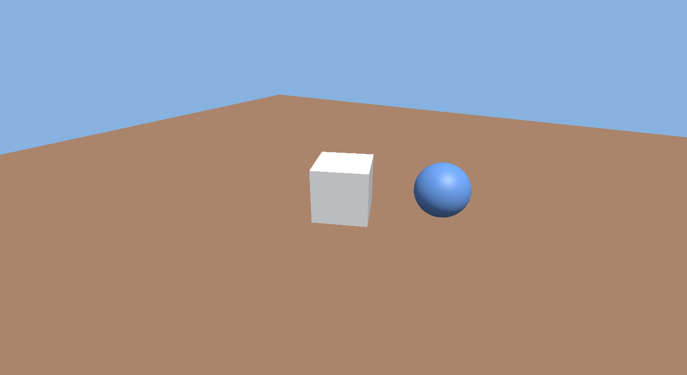

# Lapis

Lapis is a small 3D game engine with a visual editor, written entirely in C#.
Build scenes in the editor, write gameplay in C# scripts, and export your game as a standalone Windows app.

> **Status:** early development (milestone M1 — window and renderer). See [PLAN.md](PLAN.md) for the roadmap and architecture.

```csharp
using Lapis;

public class PlayerController : Behaviour
{
    public float speed = 5.0f;

    public override void Update()
    {
        float x = Input.GetAxis("Horizontal");
        float z = Input.GetAxis("Vertical");

        transform.Position += new Vector3(x, 0, -z) * speed * Time.DeltaTime;
    }
}
```

## Requirements

- Windows 10/11 x64
- [.NET 10 SDK](https://dotnet.microsoft.com/download/dotnet/10.0)
- GPU with OpenGL 4.5 support

## Building

```bash
dotnet build Lapis.slnx
```

```bash
dotnet test --solution Lapis.slnx
```

## Running

```bash
dotnet run --project src/Lapis.Editor
```

Drag with the left or right mouse button to orbit, scroll to zoom, press Esc to quit.
`--capture shot.png` renders a few frames, saves a screenshot and exits.



## Repository layout

| Path | Contents |
|---|---|
| `src/Lapis` | Engine library (`Lapis.dll`) — the API game scripts use |
| `src/Lapis.Editor` | The editor application |
| `src/Lapis.Player` | Runtime that runs exported games |
| `samples/Sandbox` | Sample game project |
| `tests/Lapis.Tests` | Unit tests |

## License

[MIT](LICENSE)
